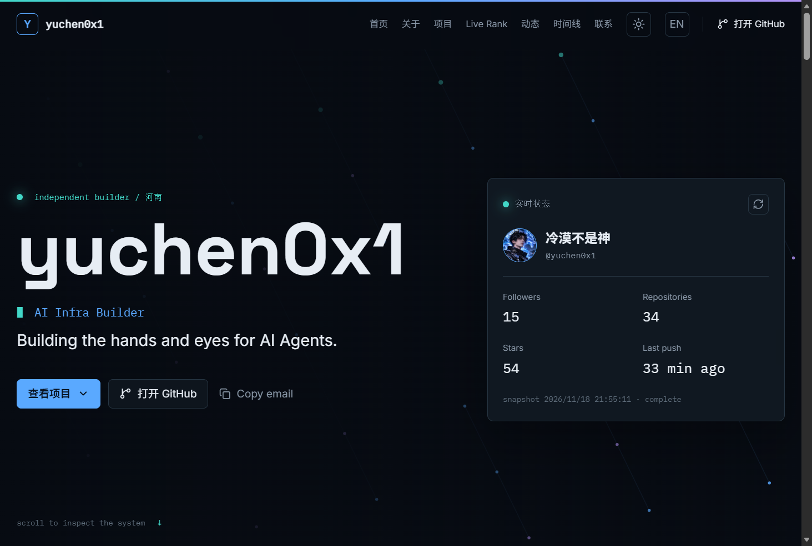

# yuchen0x1 · 独立开发者实验室

一个面向 `yuchen0x1` 的双语个人作品集。页面以公开 GitHub 快照为数据源，展示个人简介、技术栈、旗舰项目、仓库排行、动态、提交日志和创建时间线。

[访问作品集](https://lenmo.top/) · [GitHub Pages](https://yuchen0x1.github.io/) · [最近部署](https://github.com/yuchen0x1/yuchen0x1.github.io/actions/workflows/pages.yml) · [数据刷新记录](https://github.com/yuchen0x1/yuchen0x1.github.io/actions/workflows/collect.yml)

## 最新更新

### v1.1.1 · 2026-11-27

- 修复减少动态效果模式下调整窗口后背景消失，以及代理缓存反复请求的问题。
- 公开代理不再转发采集器凭据，静态服务器为页面和资源正确发送安全响应头。
- 发布说明完整保留更新模板章节，CodeQL 升级保持配对，避免检查失败。
- 移除未使用依赖和过时开发规划，保留原有安装、离线和新版本提醒流程。

[完整发布历史](docs/releases/release-notes.md)

## 功能与使用

个人简介与项目介绍支持中英切换，页面提供深浅主题、公开仓库搜索与组合筛选、Star 排行、README 摘要、GitHub 动态、最近提交和版本时间线。项目演示区域使用明确标注的示例数据。

按 Ctrl/⌘+K 打开命令面板，输入名称并回车跳转。按反引号打开终端，输入 `help` 查看命令。移动端可以使用顶部导航和仓库搜索。



## 支持平台与安装

支持现代桌面与移动浏览器。浏览器支持时，页面提供安装按钮，也可以通过浏览器菜单添加到桌面或主屏幕。完整设备与功能对照见 [平台说明](docs/platforms.md)，其中记录实测范围与待设备验证项。

[下载最新 Web 归档](https://github.com/yuchen0x1/yuchen0x1.github.io/releases/latest) 后可部署到静态服务器。Docker、NAS、更新和归档来源验证步骤见 [维护手册](docs/maintenance.md)。PWA 在新版准备好后提供确认刷新，选择稍后会在当前会话隐藏同一提醒。

## 本地运行

```powershell
npm ci
npm run dev
```

打开 `http://127.0.0.1:5173/`。生产构建使用：

```powershell
npm run typecheck
npm test
npm run test:collector
npm run lint
npm run build
```

## 数据快照

`public/data/repos.json` 和 `public/data/history.json` 是可提交的公开数据快照。手动刷新：

```powershell
node scripts/collect.mjs
```

采集器只访问固定的 GitHub 公开接口，支持 `GITHUB_TOKEN` / `GH_TOKEN` 提升速率额度。Token 只从环境变量读取，私有 ETag 缓存在被忽略的 `.cache/` 中，不会写入页面、快照或日志。

`.github/workflows/collect.yml` 计划在每小时第 17 分和第 47 分刷新快照。采集成功后，`.github/workflows/pages.yml` 从 `main` 构建 `dist/` 并部署 GitHub Pages。当前用户站点从域名根路径构建，应用的数据和 favicon 会跟随根路径。独立服务器上的 `lenmo.top` 通过发布构建更新。

## 可选代理

`examples/proxy/server.mjs` 是一个固定用户的只读 GitHub 代理示例：只允许 `yuchen0x1` 的用户、仓库语言、Release、提交和 README 路由，拒绝任意搜索或写入接口，并提供 ETag、短缓存和 CORS。

```powershell
$env:CORS_ORIGIN = 'https://lenmo.top'
node examples/proxy/server.mjs
```

默认监听 `127.0.0.1:8787`。代理仅匿名访问公开接口，不会读取或转发采集器的 GitHub Token；受匿名 API 速率限制。代理只适合部署在你自己的边缘函数或服务器上；不要把 GitHub Token 写入仓库。

## 项目结构

- `src/`：React 页面、数据模型、快照加载和 Canvas 网络背景
- `scripts/`：GitHub 采集、缓存和 Star 历史记录
- `public/data/`：公开快照
- `examples/proxy/`：固定上游代理示例
- `.github/workflows/`：快照刷新和 Pages 构建工作流

## 文档与反馈

- [开发和维护](docs/maintenance.md)
- [平台兼容性](docs/platforms.md)
- [研究与对比](docs/research/comparison.md)
- [升级候选和路线图](docs/roadmap.md)
- [贡献方式](CONTRIBUTING.md)
- [安全反馈](SECURITY.md)
- [问题反馈](https://github.com/yuchen0x1/yuchen0x1.github.io/issues/new/choose)

常见问题包括离线缓存、安装入口和更新检查，见维护手册。仓库当前没有项目级开源许可证，复用项目代码前请联系作者确认授权。发布归档包含依赖的第三方许可证文本。
